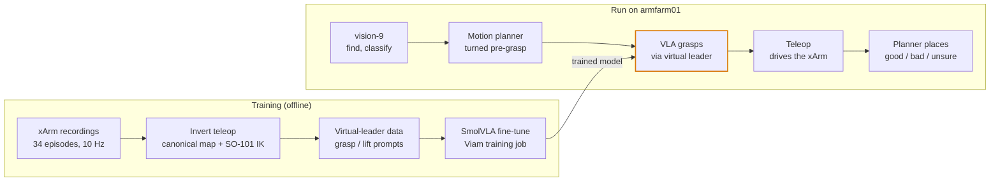

<!-- Teammate summary of the virtual-leader / SmolVLA track, added as written. -->

# armfarm01 Virtual Leader Experiments

2026-11-14

## Goal and reasoning

We recovered the SO-101 leader-arm motion behind every armfarm01 recording, fine-tuned SmolVLA on it, and ran the VLA as a virtual leader that drives the xArm850 through Viam's teleop. The bet: smolvla_base was pretrained on SO-100/SO-101 arms (5 joints + gripper), so keeping its action space should transfer better than retraining it on xArm joints.

- **The mapping is invertible.** `viam:teleop:leader-follower` maps the leader's end pose to the xArm with a fixed transform (scale 2.5, 100 mm tool offset, −90° tool rotation). Reversed: xArm joints → forward kinematics → inverse mapping → SO-101 inverse kinematics (5 joints).
- **One canonical mapping, not per-session.** Each recording session absorbed a different alignment gap (70–340 mm, 11–60°) because the leader's joint 3 stopped short. Reconstructing per session would label the same xArm pose with different joints, so every frame and the deployment use the median gap.
- **Validated against the robot's own logs.** Leader inverse kinematics error is 0.15 mm / 0.6° (median). Rebuilt leader poses match the teleop module's logged ones to 3.5 mm (378 samples). The xArm forward kinematics match logged commands to 1.4 mm. The 150 ms follower lag is compensated.

*Vision and planning aim the gripper; the VLA only has to grasp. Weak link: the VLA drifts ~80 mm off the part.*

## Datasets

Two new sequence datasets were added in the hackathons org; the source dataset was never modified.

| Dataset | ID | Contents | Role |
| --- | --- | --- | --- |
| armfarm01_pickup_v2_vleader_grasp_lift | 6af89d76aaa10113c3810b6d | 60 sequences from 30 kept episodes, split at the final grasp: `task:grasp the object` / `task:lift the object`; corrected gripper as `vleader-gripper` | Grasp/lift model |
| armfarm01_pickup_v2_virtual_leader | 6af88df3f64790cdeaf4e137 | 34 sequences, 3,804 frames: `virtual-leader` (5 joints, deg) + `virtual-leader-gripper` (%), both cameras; `task:pick up one object` | First virtual-leader model |
| armfarm01_pickup_v2 (source) | 6af88026f28d8d238dd4d5b4 | 34 sequences, 3,804 frames at 10 Hz: xArm `arm`, `gripper`, `cam`, `overview-cam` | Original recordings, unchanged |

Gripper labels are 100 × pos / 850, set to 0% for the final grasp so the policy learns to squeeze; the hold check was fixed after taped bolts (jaw stops at ~220) were missed. The split dataset drops `a2d6b178` (no grasp) and the regrasps `02217762`, `266eae94`, `44d01ea4`; episodes where the gripper opens at the start were kept.

## Models

The grasp/lift model is the one deployed; losses are in different action units, so they do not rank the models.

| Model (version) | Training job | Dataset | Actions | Final loss | Status |
| --- | --- | --- | --- | --- | --- |
| armfarm01-smolvla-vleader-gl (2026-11-14T12-42-44) | 6af89d94a6e182a00e46c113 | vleader_grasp_lift, 59 episodes, 3,315 frames | SO-101 5 joints + gripper, 2 prompts | 0.0030 | Loaded by `policy`, tested |
| armfarm01-smolvla-vleader (2026-11-14T11-40-58) | 6af88f1ba0a27f75d4994991 | virtual_leader, 34 episodes, 3,763 frames | SO-101 5 joints + gripper, 1 prompt | 0.0036 | Tested, superseded |
| armfarm01-smolvla (2026-11-14T10-57-26) | 6af884e7f64790cdeaf25267 | pickup_v2 | xArm 6 joints + gripper, 1 prompt | 0.0028 | Earlier baseline |

All three: SmolVLA from `lerobot/smolvla_base`, script `physical-ai-studio-gripper-open` v1, 20 epochs, batch 8, 224 px, 10 fps, about 44 min each on an A100.

## Robot trials

Vision plus motion planning got the gripper to the part every time; the VLA's own aim is what failed. Newest first, all on 2026-11-14 (UTC).

| Time | Setup | Result | Lesson |
| --- | --- | --- | --- |
| 19:05 | Vision pick, gripper turned to the bolt, rotation locked (2 runs) | 1 slight miss; 1 "grasp" after the VLA drifted ~80 mm off the target | VLA moves off the part; built an X/Y-locked follower (not yet tested) |
| 18:54 | `vision-9` classify (normal × 3) → pick → `good-pose` | Grasp at 8.8 s, full place sequence done; jaws were parallel to the bolt | Added gripper turn to 90° of the bolt axis |
| 18:39–18:42 | Vision-guided pick: YOLO + depth → planned pre-grasp → VLA `grasp the object` (4 runs) | 2 grasps (jaw stalled 241, 284), lift → `good-pose` → open → `inspect-pose`; 2 timeouts, one on the wrong object | Works sometimes; choose the target better |
| 18:29–18:33 | Grasp/lift model from `inspect-pose` (2 runs) | No grasp: descends, closes beside the bolt, dithers 3–14% | Learned the average motion, not where the bolt is |
| 18:02–18:12 | First virtual-leader model (3 runs) | 4.5 s run cut by a grasp-check bug; one closed on nothing; one lost the connection at 18.6 s | Fixed the grasp check; stop now reconnects and confirms |

The chain itself ran cleanly every time: about 10 fps, alignment within 1 mm from `inspect-pose`, no teleop pipeline errors, clean stops.

## Findings and next steps

The virtual leader is accurate and the pipeline runs end to end; the bottleneck is data. With 30 demos spread over 19 grasp spots, the policy learned the average pick motion rather than reading the bolt's position from the image.

- **Next to test:** `follower-xy`, which passes only the VLA's vertical motion and gripper to the xArm, with X, Y and rotation locked at the planned pre-grasp pose. The module is deployed; the service is not yet added.
- **Fallback:** a scripted descend-and-close grasp, since vision and planning already place the gripper within a few millimetres.
- **More data:** 50–100 demos with parts spread across the board, a one-second hold at the end, and a few deliberate miss-and-retry demos.
- **Rollback:** the pre-update snapshot is `virtual-leader/data/snapshots/20261114T191718Z`; `src/apply_config.py --rollback` removes all added resources and restores the original `policy` model.
